<picture>
  <source media="(prefers-color-scheme: dark)" srcset="assets/header-dark.svg">
  
</picture>

  
  
  

> O diferencial hoje não é digitar código mais rápido.
> É saber **o que** construir, **por quê**, e garantir que o resultado está certo.

Sou engenheiro de software na **[Gobrax](https://www.gobrax.com.br)**, gestão de frotas e telemetria veicular. Faço parte de um time pequeno construindo um produto novo com software embarcado no veículo, e atuo em todas as pontas dele: **embarcado, app mobile, serviços back-end e análise de dados**.

Cheguei aqui pelo caminho mais longo. Comecei no suporte de TI da Força Aérea, entrei na Gobrax atendendo cliente, levei Python e SQL pro suporte quando ninguém usava, e em pouco mais de um ano estava fundando o time de dados e construindo do zero o primeiro data warehouse da empresa. **Dado de telemetria é o meu chão; produto é onde ele vira valor.**

## Como eu trabalho

Desenvolvimento **AI-Native e orientado a especificação**. A IA executa o que foi definido. As decisões são minhas e do time.

| Pesquisa | Spec | Validação | Execução |
|:--|:--|:--|:--|
| Contexto do problema, requisitos, restrições do hardware e do negócio | Fluxos, contratos e critérios de aceite escritos antes da primeira linha | Revisão técnica com o time: ajusta-se a spec, não o código | Claude Code guiado pela spec, MR revisado com skills de IA |

Pra isso funcionar em equipe, ajudei a estruturar a **wiki de contribuição** do time, **skills de IA para code review** e para tratar revisões recebidas, e o processo que liga essas quatro etapas. O efeito é menos retrabalho e MRs que chegam consistentes.

## Registro

<picture>
  <source media="(prefers-color-scheme: dark)" srcset="assets/painel-dark.svg">
  
</picture>

Gerado todo dia por uma GitHub Action deste repositório, no mesmo papel do tacógrafo. A maior parte do meu trabalho diário acontece em repositórios privados.

## Trajetória

| Quando | Onde | O que ficou |
|:--|:--|:--|
| **Hoje** | Gobrax · Back-End Developer | Produto novo embarcado no veículo, do embarcado ao app. Specs, Claude Code, wiki do time e skills de code review que padronizaram os merge requests |
| **2025** | Gobrax · Analista de Dados Pleno | Promovido em 8 meses. *Raio-X de Veículos* para medir a saúde do dado da frota, modelo de permanência em concessionária DAF a partir da posição dos veículos, **500+ dashboards Power BI** mantidos e dados modelados para outros analistas consumirem sozinhos |
| **2024** | Gobrax · Analista de Dados Jr | **Fundador do time de dados.** Data warehouse do zero em GCP com BigQuery e Cloud Storage, pipelines em Airflow integrando webhooks, logs, HubSpot e telemetria de veículos e motoristas |
| **2023** | Gobrax · Suporte N1 | Primeiro a levar Python e SQL pro suporte. **Modelo preditivo de saúde de bateria** com voltagem, RPM e ignição para antecipar falha em campo |
| **2020** | Força Aérea · CINDACTA II | Suporte técnico N1/N2, hardware, redes e ativos de TI num ambiente onde o sistema não pode cair |

## Projetos

### [lakehouse_education](https://github.com/jpdagostin/lakehouse_education)
**Arquitetura medallion (Bronze → Silver → Gold) com PySpark e Delta Lake.** Reprocessar o mesmo lote duas vezes não pode duplicar nada; se duplicar, o pipeline está errado, não o dado.

- Eventos de matrícula chegando de CDC e backfill, fora de ordem, duplicados e com campos parciais
- Deduplicação desacoplada do id do evento, prioridade de fonte (CDC acima de backfill) com desempate em cascata por window functions
- Forward-fill por entidade e escrita via `MERGE`: idempotência de verdade
- Schema evolution com `mergeSchema` quando o formato muda de CSV para JSON no meio do caminho
- pytest nos casos de borda, CI no GitHub Actions, Ruff, uv e auditoria por time travel do Delta

`PySpark` `Delta Lake` `pytest` `GitHub Actions` `uv`

### [project-tse](https://github.com/jpdagostin/project-tse)
**Priorização de auditorias eleitorais com Isolation Forest.** O TSE recebe dezenas de milhares de prestações de contas por eleição. Por onde um auditor deveria começar?

- Os dados não trazem o resultado dos julgamentos, então classificação supervisionada não é opção
- Features comportamentais (como o dinheiro foi usado, não quanto havia) e um modelo por cargo: prefeito com prefeito, vereador com vereador
- Paraná, eleições municipais 2024: **30.000 candidatos analisados, 897 sinalizados**, cada alerta com o motivo em linguagem simples
- API em FastAPI para consultar os scores

A IA prioriza; quem decide é o auditor.

`Python` `scikit-learn` `Isolation Forest` `SHAP` `FastAPI`

### Almagos em construção · privado
**Plataforma de nutrição clínica**, construída do jeito que descrevi acima: spec primeiro. Serviços e bibliotecas de domínio em Go, painel do nutricionista em Next.js, app do paciente em React Native, atendimento por WhatsApp com máquina de estados conversacional e uma camada de IA clínica para biomarcadores e prescrições.

`Go` `TypeScript` `Next.js` `React Native` `LLMs`

## Stack

  
  
  
  
  
  
   
  
  
  
  
  
   
  
  
  
  
  
  

**Formação** · Engenharia de Software (UniBrasil) · Pós em Ciência de Dados (UNICURITIBA) · Pós em Inteligência Artificial *(em andamento)*

**Escrevendo** · publico sobre engenharia de dados e IA aplicada no [LinkedIn](https://www.linkedin.com/in/jpdagostin/), onde mais de 1.600 pessoas acompanham.

<b>Read in English</b>

 

> The edge today isn't typing code faster.
> It's knowing **what** to build, **why**, and making sure the result is right.

I'm a software engineer at **[Gobrax](https://www.gobrax.com.br)**, a fleet management and vehicle telemetry company in Curitiba, Brazil. I'm part of a small team building a new in-vehicle embedded product and I work across all of it: **embedded software, mobile app, back-end services and data analysis**.

I took the long road here. I started in IT support at the Brazilian Air Force, joined Gobrax answering customers, brought Python and SQL into the support team when nobody used them, and a little over a year later I was founding the data team and building the company's first data warehouse from scratch.

**How I work.** AI-native, spec-driven development: research, then a written spec with flows, contracts and acceptance criteria, then validation with the team, then implementation on Claude Code guided by that spec. The AI executes what was defined; the decisions stay with us. I helped set up the team wiki, AI skills for code review, and the process that ties those steps together.

**Path.**
- **Now** · Back-End Developer on a new in-vehicle product
- **2025** · Mid-level Data Analyst: fleet data health model, dealership dwell-time model from vehicle positions, 500+ Power BI dashboards
- **2024** · Founding member of the data team: GCP data warehouse from zero with BigQuery, Cloud Storage and Airflow
- **2023** · Fleet platform support: brought Python and SQL in, built a battery health prediction model from voltage, RPM and ignition
- **2020** · IT support at the Brazilian Air Force (CINDACTA II)

**Projects.**
- [lakehouse_education](https://github.com/jpdagostin/lakehouse_education): medallion architecture on PySpark and Delta Lake with idempotent `MERGE`, source priority, forward-fill and schema evolution, tested and CI-checked
- [project-tse](https://github.com/jpdagostin/project-tse): Isolation Forest over Brazilian electoral finance data, 30,000 candidates analyzed and 897 flagged, every alert explained, served through FastAPI
- **Almagos** (private, in progress): clinical nutrition platform with Go services, Next.js, React Native, a WhatsApp state machine and a clinical AI layer

