<picture>
  <source media="(prefers-color-scheme: dark)" srcset="assets/header-dark.svg">
  
</picture>

> O diferencial hoje não é digitar código mais rápido.
> É saber **o que** construir, **por quê**, e garantir que o resultado está certo.

Sou engenheiro de software na **[Gobrax](https://www.gobrax.com.br)**, gestão de frotas e telemetria veicular. Faço parte de um time pequeno construindo um produto novo com software embarcado no veículo, e atuo em todas as pontas dele: embarcado, app mobile, serviços back-end e análise de dados.

Antes disso, fundei o time de dados da empresa e construí do zero o primeiro data warehouse. Dado de telemetria é o meu chão.

### Como eu trabalho

```
pesquisa  →  spec  →  validação com o time  →  execução com Claude Code
```

Desenvolvimento **AI-Native e orientado a especificação**. Levanto requisitos, desenho os fluxos e escrevo a spec antes da primeira linha. A IA executa o que foi definido; as decisões são minhas e do time. Pra isso funcionar em equipe, ajudei a estruturar a wiki de contribuição, skills de IA para code review e um processo que corta retrabalho.

### Trajetória

| Quando | Onde | O que ficou |
|:--|:--|:--|
| **Hoje** | Gobrax · Back-End Developer | Produto novo embarcado no veículo. Specs, Claude Code, wiki do time, skills de code review |
| **2025** | Gobrax · Analista de Dados Pleno | *Raio-X de Veículos* (saúde do dado da frota), modelo de permanência em concessionária DAF, 500+ dashboards Power BI |
| **2024** | Gobrax · Analista de Dados Jr | Fundador do time de dados. Data warehouse do zero em GCP com BigQuery, Cloud Storage e Airflow |
| **2023** | Gobrax · Suporte N1 | Primeiro a levar Python e SQL pro suporte. Modelo preditivo de saúde de bateria com voltagem, RPM e ignição |
| **2020** | Força Aérea · CINDACTA II | Suporte técnico N1/N2, hardware e redes. Disciplina de quem não pode deixar o sistema cair |

### Projetos

**[lakehouse_education](https://github.com/jpdagostin/lakehouse_education)** · arquitetura medallion com PySpark e Delta Lake<br>
Reprocessar o mesmo lote duas vezes não duplica nada. Deduplicação desacoplada do id do evento, prioridade de fonte (CDC acima de backfill), forward-fill por entidade, `MERGE` idempotente e schema evolution com `mergeSchema`. Testes em pytest e CI no GitHub Actions.

**[project-tse](https://github.com/jpdagostin/project-tse)** · priorização de auditoria eleitoral com Isolation Forest<br>
O TSE não publica o resultado dos julgamentos, então não dá pra supervisionar. O modelo aprende o comportamento financeiro normal por cargo e aponta quem desvia. Paraná 2024: **30.000 candidatos analisados, 897 sinalizados**, com o motivo de cada alerta explicado e uma API em FastAPI. A IA prioriza; quem decide é o auditor.

**Almagos** · plataforma de nutrição clínica, em construção *(privado)*<br>
Serviços em Go, web do nutricionista em Next.js, app do paciente em React Native, atendimento por WhatsApp com máquina de estados e uma camada de IA clínica. Construído do jeito que descrevi acima: spec primeiro.

### Stack

**No dia a dia** &nbsp; `Python` `Go` `SQL` `PostgreSQL` `Cassandra` `RabbitMQ` `Docker`<br>
**Dados** &nbsp; `BigQuery` `Airflow` `dbt` `GCP` `Power BI`<br>
**IA** &nbsp; `Claude Code` `Spec-Driven Development` `LLMs` `FastAPI`<br>
**Em projetos** &nbsp; `PySpark` `Delta Lake` `pytest` `GitHub Actions` `scikit-learn`

**Formação:** Engenharia de Software (UniBrasil) · Pós em Ciência de Dados (UNICURITIBA) · Pós em Inteligência Artificial *(em andamento)*

<details>
<summary><b>Read in English</b></summary>

<br>

> The edge today isn't typing code faster.
> It's knowing **what** to build, **why**, and making sure the result is right.

I'm a software engineer at **[Gobrax](https://www.gobrax.com.br)**, a fleet management and vehicle telemetry company in Curitiba, Brazil. I'm part of a small team building a new in-vehicle embedded product, working across all of it: embedded software, mobile app, back-end services and data analysis.

Before that, I founded the company's data team and built its first data warehouse from scratch. Telemetry data is my home turf.

**How I work.** AI-native, spec-driven development: research, requirements, flows and a written spec come first; implementation runs on Claude Code guided by that spec and validated with the team. The AI executes what was defined; the decisions stay with us. I helped set up the team wiki, AI skills for code review, and a research → spec → validation → execution process that cuts rework.

**Path.** Air Force IT support (2020) → fleet platform support, where I brought Python and SQL in and built a battery health prediction model (2023) → founding member of the data team, GCP data warehouse from zero (2024) → mid-level data analyst, 500+ Power BI dashboards (2025) → back-end developer on a new embedded product (2025, now).

**Projects.** [lakehouse_education](https://github.com/jpdagostin/lakehouse_education): medallion architecture on PySpark and Delta Lake with idempotent `MERGE`, source priority and schema evolution, tested and CI-checked. [project-tse](https://github.com/jpdagostin/project-tse): Isolation Forest over Brazilian electoral finance data, 30,000 candidates analyzed and 897 flagged, every alert explained.

</details>

---

[LinkedIn](https://www.linkedin.com/in/jpdagostin/) · [Portfólio](https://jpdagostin.github.io/jpdagostin-portifolio/) · [dagostinjoaopedro@gmail.com](mailto:dagostinjoaopedro@gmail.com)
